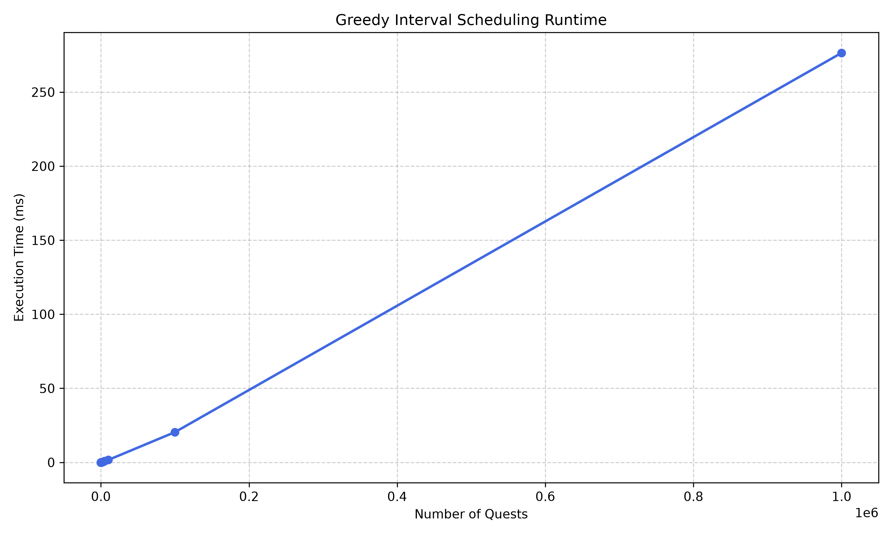
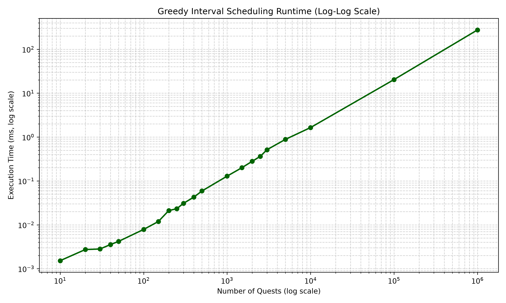

# greedy-interval-scheduling

A C++ implementation and empirical analysis of the classic **Activity Selection Problem** using a greedy algorithm. The project helps Geralt the Witcher choose the maximum number of non-overlapping community service quests that can be completed within a day.

---

## Overview

Geralt considers undertaking a set of unpaid community service quests.

Each quest occupies a time interval:

```text
[start, end)
```

Some quests overlap and therefore cannot be completed together.

The objective is to select the maximum possible number of non-overlapping quests.

This problem is solved using the classic **Greedy Interval Scheduling Algorithm**, which produces an optimal solution while maintaining high efficiency even for very large datasets.

---

## Problem Statement

Given a set of quests:

```text
Q1 = [s1, t1)
Q2 = [s2, t2)
...
Qn = [sn, tn)
```

select the largest subset of mutually compatible (non-overlapping) quests.

### Example

Input:

```text
[1,4)
[3,5)
[0,6)
[5,7)
[8,9)
[5,9)
```

Optimal solution:

```text
[1,4)
[5,7)
[8,9)
```

Total quests completed:

```text
3
```

---

## Data Structure

Each quest is represented by:

```cpp
struct Quest
{
    int start;
    int end;
};
```

---

## Algorithm

### Greedy Interval Scheduling

The algorithm follows a well-known greedy strategy:

1. Sort all quests by increasing finishing time.
2. Select the quest that finishes earliest.
3. Repeatedly select the next quest whose start time is not earlier than the end time of the last selected quest.

Implementation:

```cpp
sort(
    quests.begin(),
    quests.end(),
    [](const Quest& a, const Quest& b)
    {
        if (a.end != b.end)
        {
            return a.end < b.end;
        }

        return a.start < b.start;
    }
);

for (const Quest& q : quests)
{
    if (q.start >= currentEnd)
    {
        chosen.push_back(q);
        currentEnd = q.end;
    }
}
```

---

## Why the Algorithm Works

The greedy choice is to always select the quest that finishes earliest among all available quests.

This strategy is optimal because the earliest finishing quest leaves the largest possible amount of remaining time for scheduling future quests.

Any schedule that does not select the earliest finishing compatible quest can be transformed into one that does without reducing the number of quests completed.

Therefore, the greedy solution always produces a maximum-size set of non-overlapping quests.

---

## Complexity Analysis

### Sorting

```text
O(n log n)
```

### Quest Selection

```text
O(n)
```

### Overall Complexity

```text
O(n log n)
```

### Space Complexity

```text
O(n)
```

The sorting phase dominates the execution time, while the actual greedy selection requires only a single linear scan through the quest list.

---

## Benchmarking Methodology

Execution time was measured using:

```cpp
QueryPerformanceCounter()
```

from the Windows API.

Random quest datasets were generated using:

```cpp
GenerateRandomQuests(int n)
```

Dataset sizes:

```text
10
20
30
40
50
100
150
200
250
300
400
500
1000
1500
2000
2500
3000
5000
10000
100000
1000000
```

For each dataset, the algorithm was executed repeatedly and the average runtime was recorded.

---

## Experimental Results

### Benchmark Data

| Number of Quests | Runtime (ms) |
|------------------:|-------------:|
| 10 | 0.0015 |
| 100 | 0.0079 |
| 1,000 | 0.1287 |
| 10,000 | 1.6469 |
| 100,000 | 20.4165 |
| 1,000,000 | 276.483 |

The measured execution times increase steadily with the number of quests and remain consistent with the expected:

```text
O(n log n)
```

behavior.

Because the algorithm spends most of its time sorting the intervals, the growth rate closely follows the complexity of the sorting phase.

---

## Generated Figures

### Runtime Comparison



This graph shows execution time as a function of the number of quests.

Observations:

- Runtime increases smoothly as the input size grows.
- The growth rate is significantly slower than quadratic behavior.
- The algorithm remains efficient even for very large datasets.
- The dominant cost comes from sorting the intervals before scheduling.

---

### Logarithmic Runtime Comparison



Using logarithmic scales makes it easier to visualize performance across multiple orders of magnitude.

Observations:

- The plotted points form an approximately straight ascending line.
- Runtime growth remains predictable from 10 quests up to 1,000,000 quests.
- The measurements closely match the expected complexity of:

```text
O(n log n)
```

- Processing one million randomly generated quests required approximately:

```text
276 ms
```

demonstrating excellent scalability.

---

## Setup

### Prerequisites

- C++17 compatible compiler
- Windows operating system
- Python 3.13+ (for graph generation)

---

## Build

```bash
g++ src/main.cpp src/Scheduler.cpp -o benchmark
```

---

## Usage

Run:

```bash
./benchmark.exe
```

The program:

1. Demonstrates the algorithm on a sample dataset.
2. Generates random quest datasets.
3. Benchmarks runtime performance.
4. Saves measurements to a CSV file.

Example output:

```text
Selected quests:
[1, 3)
[3, 5)
[5, 7)
[8, 9)
0000 | Time: 1.647 ms
...
```

---

## Benchmark Output

Results are automatically written to:

```text
data/benchmark.csv
```

Example format:

```csv
Size,TimeMs
10,0.0015
20,0.0027
...
1000000,276.483
```

---

## Generate Graphs

Install dependencies:

```bash
py -3.13 -m pip install pandas matplotlib
```

Run:

```bash
py -3.13 graph.py
```

Generated files:

```text
report/
├── runtime_comparison.png
└── runtime_logarithmic.png
```

---

## Project Structure

```text
greedy-interval-scheduling
│
├── data/
│   └── benchmark.csv
│
├── report/
|   |── graph.py
│   ├── runtime_comparison.png
│   └── runtime_logarithmic.png
│
├── src/
│   ├── Quest.h
│   ├── Scheduler.h
│   ├── Scheduler.cpp
│   └── main.cpp
│
├
├── README.md
└── benchmark.exe
```

---

## Conclusion

A greedy interval scheduling algorithm was implemented to maximize the number of non-overlapping quests selected from a set of time intervals.

Experimental benchmarking confirmed the expected theoretical complexity:

```text
O(n log n)
```

The results demonstrate that the algorithm scales efficiently even for very large datasets. Processing one million randomly generated quests required less than 300 milliseconds on the test machine, confirming that greedy scheduling is both theoretically optimal and practically efficient for large interval scheduling problems.

---

## Author

**Desire Roslin Dziele**  
Computer Science Student  
University of Łódź